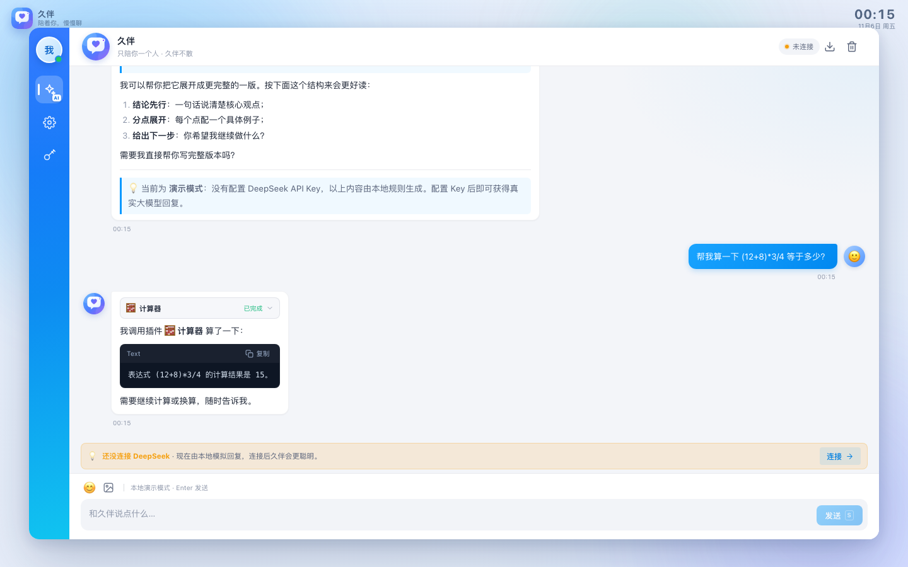
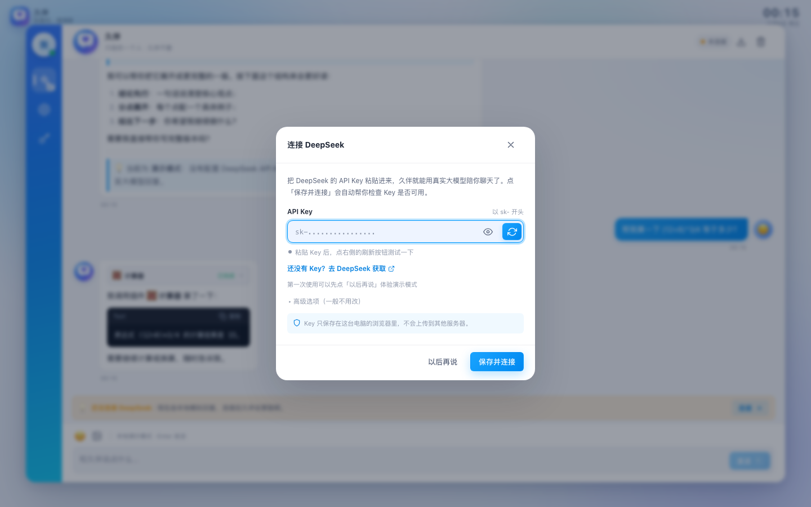
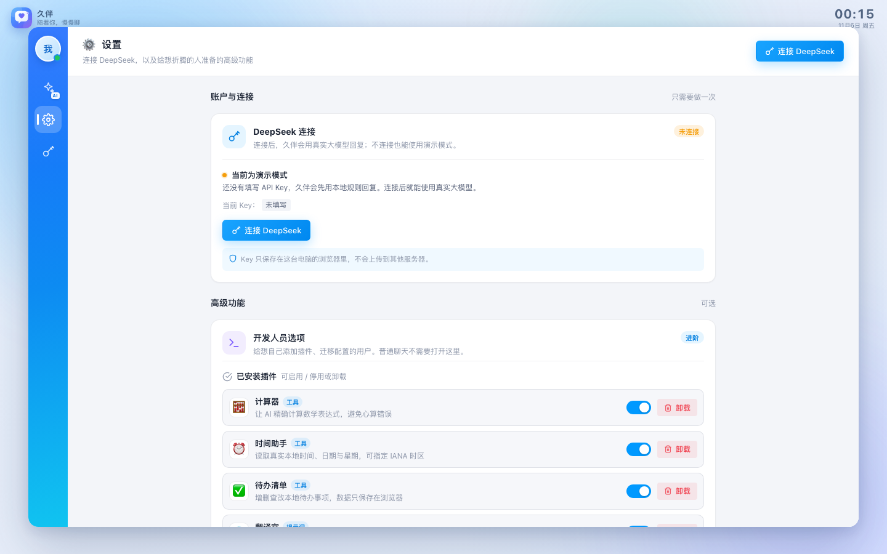

# 久伴 · 只陪你聊天的桌面应用

> 一个**不用懂 AI 也能直接用**的桌面端聊天网页应用。只有一个好友「久伴」，粘贴一次 DeepSeek API Key，就能开始聊天。
>
> 纯前端、零依赖、无需构建。所有数据都保存在你自己的浏览器里。




---

## 目录

- [功能说明](#功能说明)
- [快速开始](#快速开始)
- [第一次使用：连接 DeepSeek](#第一次使用连接-deepseek)
- [聊天怎么用](#聊天怎么用)
- [插件（可选）](#插件可选)
- [数据与隐私](#数据与隐私)
- [常见问题](#常见问题)
- [技术说明](#技术说明)

---

## 功能说明

- **只有一个好友「久伴」**：没有好友列表、没有群聊、没有复杂设置，打开就是聊天窗口。
- **左侧图标全部靠上**：AI 聊天（✨AI）、设置（⚙️）、连接 DeepSeek（🔑）集中排列。
- **极简连接**：右上角「未连接」或左侧导航栏的钥匙按钮 → 弹出一个小窗口 → 粘贴 API Key → 点小刷新按钮测试 → 保存，就能用真实大模型聊天。
- **对新手友好**：没填 Key 也能先用「演示模式」熟悉界面；界面只保留聊天必需功能，模型、接口地址等参数收在「高级选项」里，默认不用管。
- **完整聊天能力**：文字、表情、图片（选择/拖拽/粘贴）、Markdown、代码块、消息复制/删除、重新生成、停止生成、导出聊天记录。
- **可选插件**：需要时在「设置 → 开发人员选项」里添加计算器、时间、待办等小能力；不装也完全不影响聊天。
- **开发人员选项**：想自己扩展的用户，可以在「设置」里添加内置插件、写自定义插件、导入/导出插件配置。
- **浅色界面**：专注阅读与聊天，不提供深色模式。
- **响应式**：电脑、平板、手机浏览器都能使用。






---

## 快速开始

> ⚠️ 不能直接双击 `index.html` 打开（浏览器会拦截网页脚本）。请用下面的任意一种方式启动本地服务器。

### 方式一：Node.js（推荐）

要求 Node.js ≥ 18。

```bash
cd 挑杯项目
node serve.mjs
```

浏览器打开 <http://127.0.0.1:5188>。

同一 Wi-Fi 下的手机/电脑可以使用终端打印的「局域网访问」地址访问。只想允许本机访问时：

```bash
HOST=127.0.0.1 node serve.mjs
```

换端口：

```bash
PORT=8080 node serve.mjs
```

### 方式二：Python

```bash
cd 挑杯项目
python3 -m http.server 5188 --bind 0.0.0.0
```

浏览器打开 <http://127.0.0.1:5188>；局域网设备用 `http://你的局域网IP:5188`。

### 方式三：任意静态服务器

Nginx、`npx serve`、VS Code Live Server 等均可，只要把项目根目录作为站点根目录。

---

## 分享给别人使用

久伴是纯前端静态应用，**不需要服务器后端**，但对方不能直接双击 `index.html`。可以选下面任意一种方式：

### 方式 A：同一局域网临时共享（最快）

在你这台电脑的项目目录运行：

```bash
node serve.mjs
```

启动后终端会直接打印「局域网访问」地址，例如：

```text
本机访问: http://127.0.0.1:5188
局域网访问: http://10.120.117.93:5188  (en0)
```

让对方在同一 Wi-Fi 下打开局域网地址即可。

注意：

- 终端要一直开着（关闭终端服务就停了）；
- 如果对方打不开，检查 macOS 防火墙是否允许 Node 接收连接；
- 部分公司/校园 Wi-Fi 开启了「AP 隔离」，设备之间不能互访，这种情况可以改用手机热点或普通家用路由器。

### 方式 B：部署到 GitHub Pages / 静态托管（推荐长期使用）

把整个项目目录上传到任意静态托管即可（GitHub Pages / Vercel / Netlify / Nginx / 对象存储）：

- 不需要构建、不需要后端、不需要数据库；
- 入口就是 `index.html`，所有路径都是相对路径；
- 对方打开网址后，在连接窗口里填自己的 DeepSeek API Key 就能用。

GitHub Pages 的完整步骤（含后续维护、版本更新、回滚）见 [DEPLOY.md](DEPLOY.md)。

### 方式 C：拷贝到对方电脑运行

- 对方电脑需要安装 Node.js ≥ 18（或 Python 3）；
- 在项目目录执行 `node serve.mjs`，再打开 `http://127.0.0.1:5188`；
- 仍然不能直接双击 `index.html`（浏览器会拦截网页脚本）。

### 使用边界

- **每个使用者需要自己的 DeepSeek API Key**，Key 只存在各自的浏览器里，不要把自己的 Key 交给别人或写进代码；
- 聊天记录、插件设置也都只保存在各自浏览器，**不会在不同电脑之间同步**；
- 公开部署的页面没有登录/权限控制，任何拿到网址的人都可以打开并把**自己的** Key 填进去聊天；
- 如果使用第三方 DeepSeek 兼容代理，对方浏览器访问该代理时需要支持 CORS。

---

## 第一次使用：连接 DeepSeek

### 1. 获取 API Key

前往 DeepSeek 开放平台创建 API Key：<https://platform.deepseek.com/api_keys>

> Key 形如 `sk-xxxxxxxxxxxxxxxx`。久伴不会替你申请 Key，也不会把 Key 发送到 DeepSeek 官方接口以外的任何地方。

### 2. 打开连接窗口

在聊天页点击以下任意一个位置：

- 右上角的 **「未连接」** 小胶囊
- 左侧导航栏的 **钥匙按钮**
- 页面底部提示条上的 **「连接」** 按钮

会弹出一个小窗口，只有三件事要做：

1. 把 API Key 粘贴到输入框；
2. 点击输入框右侧的 **刷新小按钮**，看到「连接成功」说明 Key 可用；
3. 点击 **保存并连接**。

> 保存时会自动再检查一次 Key。检查通过后，右上角会从「未连接」变成「已连接」，之后久伴就会用真实大模型回复。

### 3. 高级选项（不懂可以完全跳过）

展开「高级选项」后可以修改：

- **接口地址**：默认 `https://api.deepseek.com`，只有使用第三方兼容代理时才需要改；
- **模型名称**：默认 `deepseek-flash`，一般不需要改。

### 4. 如果不想填 Key

直接点「以后再说」即可进入**演示模式**：

- 回复由本地规则生成，不会发送任何网络请求；
- 仍可体验聊天、表情、图片、插件；
- 随时点击右上角「未连接」再连接 DeepSeek。

### 5. 安全说明

- API Key 只保存在**当前电脑的浏览器**（localStorage）里，不会上传到其他服务器；
- 只在发起对话时作为请求头发送给配置的 DeepSeek 接口；
- 想断开连接：打开连接窗口 → 点「清除已保存的 Key」；
- 在公共电脑上用完建议清除。

---

## 聊天怎么用

| 操作 | 说明 |
| --- | --- |
| 发送消息 | Enter 发送；Shift + Enter 换行 |
| 表情 | 点击输入框上方的 😊 |
| 图片 | 点击图片按钮，或直接把图片拖进输入框 / 粘贴图片（≤ 1.2MB，仅本地预览） |
| 复制 / 删除消息 | 鼠标移到消息上，会出现小按钮 |
| 重新生成 | 最后一条回复下方可点「重新生成」 |
| 停止生成 | 生成中点击「停止」，已生成内容会保留 |
| 导出聊天记录 | 聊天页右上角下载按钮，导出 Markdown 文件 |
| 清空聊天记录 | 聊天页右上角垃圾桶按钮（需确认） |
| 插件 | 打开「设置 → 开发人员选项」管理插件 |

---

## 插件（可选）

插件是给久伴增加的小能力，不安装也不影响正常聊天。左侧侧边栏不再有插件入口，所有插件操作都集中在 **⚙️ 设置 → 开发人员选项**。

- **工具类插件**：计算器、时间助手、待办清单、单位换算、骰子、随机选择、密码/UUID 等，由模型在需要时自动调用；
- **提示词类插件**：翻译官、周报助手、代码审查员等，让久伴多一种专业回答方式。

在「设置 → 开发人员选项」里可以：

1. 查看 **已安装插件**，随时启用 / 停用或卸载；
2. **添加内置插件**（天气、骰子、单位换算、搜索、周报、代码审查等，默认只装 4 个）；
3. **添加自定义插件**：用一段提示词给久伴增加专属技能，可随时编辑或删除；
4. 导入 / 导出插件配置 JSON；
5. 一键重置插件，恢复默认预装的 4 个插件。

> 普通聊天不需要打开开发人员选项；这里只是给想自己折腾插件的人准备的。

> 天气、联网搜索等插件为**演示数据**，不会联网，也不会泄露隐私。

---

## 数据与隐私

久伴没有后端服务，所有数据都保存在你自己的浏览器里：

| localStorage Key | 内容 |
| --- | --- |
| `jiuban.state.v1` | 聊天记录、API Key 等设置 |
| `jiuban.plugins.v1` | 插件安装与启用状态、自定义插件 |
| `jiuban.plugins.todos.v1` | 待办清单数据 |

- 图片以 Data URL 形式保存在本地，建议不要发送过多大图；
- 清除浏览器数据、使用无痕模式或更换浏览器会导致数据丢失；
- 想重新开始：在浏览器开发者工具里删除上面几个 key，或清除该站点的浏览器数据；
- 想断开 DeepSeek：打开连接窗口 → 清除已保存的 Key；
- 项目不引入统计、埋点、第三方字体或 CDN 资源。

---

## 常见问题

**Q：双击 index.html 为什么是空白？**
A：网页脚本不能通过 `file://` 运行。请使用 `node serve.mjs` 或任意静态服务器（见「快速开始」）。

**Q：提示「API Key 无效或已失效」？**
A：检查 Key 是否复制完整、是否过期、账户是否有余额；使用第三方代理时检查接口地址是否正确。

**Q：必须填 API Key 吗？**
A：不是。不填也能用演示模式聊天；填了才会使用真实的 DeepSeek 大模型。

**Q：Key 安全吗？**
A：只保存在当前浏览器，不会上传到其他服务器；公共电脑上建议用完清除。

**Q：回复很慢 / 显示「深度思考」？**
A：DeepSeek 思考模式默认开启，复杂问题会先思考再回答；可以在「高级选项」里换模型，或耐心等待。

**Q：天气、联网搜索是真实数据吗？**
A：不是，两个插件是演示数据，会明确标注，不联网。

**Q：支持深色模式吗？**
A：当前版本只提供浅色界面。

**Q：支持哪些浏览器？**
A：Chrome / Edge / Safari 近两年版本。

---

## 技术说明

- **零依赖、零构建**：原生 HTML + CSS + ES Modules，所有资源本地化，只依赖一个静态服务器。
- **设计**：浅色、简洁，保留桌面端聊天窗口的布局与动效；品牌图标在 `assets/icons/jiuban.svg`。
- **状态管理**：`store.js` 单例 + localStorage 防抖持久化。
- **安全渲染**：用户与 AI 文本先转义再渲染，Markdown 渲染器只输出白名单标签；插件执行器完全本地，不使用 `eval` / `new Function`。
- **流式对话**：手写 SSE 解析，支持 `content` / `reasoning_content` / `tool_calls`，支持中断与错误提示。
- **函数调用**：最多 4 轮「模型请求工具 → 本地执行 → 结果回传」。

### 文件结构

```text
挑杯项目/
├── index.html                  # 应用外壳（左侧导航 + 聊天窗口）
├── serve.mjs                   # 零依赖本地静态服务器（node serve.mjs）
├── package.json
├── README.md
├── assets/
│   ├── icons/
│   │   └── jiuban.svg          # 品牌图标（favicon / 壁纸 / 头像）
│   ├── css/
│   │   ├── tokens.css          # 设计令牌 + 共享组件
│   │   ├── layout.css          # 壁纸 / 侧栏 / 布局
│   │   ├── chat.css            # 聊天区 / 气泡 / 输入区
│   │   ├── api-key.css         # DeepSeek 连接小窗口
│   │   ├── settings.css        # 设置页 / 开发人员选项
│   │   └── plugins.css         # 插件添加 / 编辑表单样式
│   └── js/
│       ├── app.js              # 启动、hash 路由、连接入口
│       ├── store.js            # 全局状态与持久化
│       ├── data.js             # 好友「久伴」/ 默认会话 / 欢迎语
│       ├── util.js             # DOM、Markdown、Toast、Modal、图标
│       ├── chat.js             # 消息渲染、流式对话编排
│       ├── api.js              # DeepSeek 客户端
│       ├── api-key-dialog.js   # 简化的 API Key 连接窗口
│       ├── settings-view.js    # 设置页 / 开发人员选项
│       ├── plugin-editor.js    # 添加 / 编辑自定义插件弹窗
│       └── plugins.js          # 插件注册表与执行器
├── docs/                       # README 截图与图标
└── .qa/                        # 开发期的界面 / 功能验收脚本与截图
```

### 本地开发

修改 `assets/` 下的文件后刷新浏览器即可，无需构建。`node serve.mjs` 默认禁用缓存。

---

## 版本

**v1.6.0** — 纯前端 · 零依赖 · 数据不出本机。

如果这个项目对你有帮助，欢迎自行 fork 扩展：真实联网插件、语音输入、消息引用回复等。
