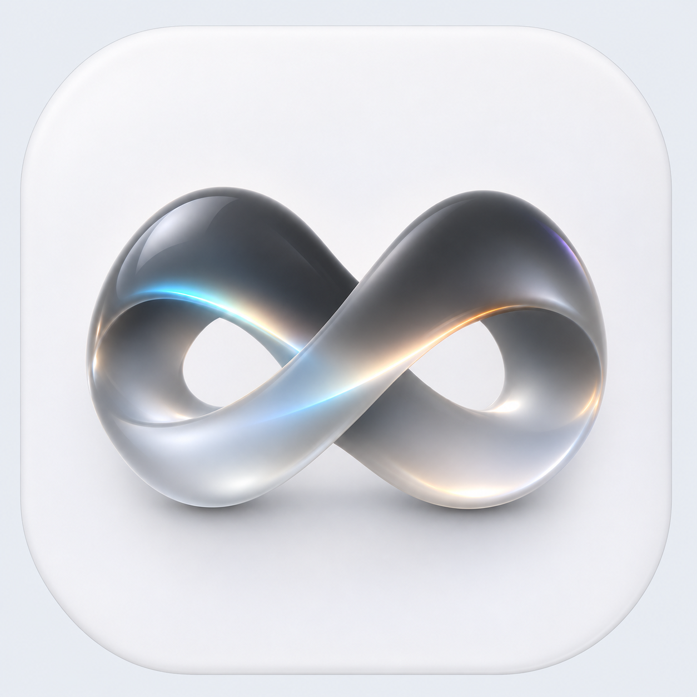

# Memora · 记忆回环



图标为Memora 创作，以相互环抱的连续双环表现长期记忆、身份延续与持续陪伴。烟灰玻璃、珍珠银和细微虹彩呼应用户提供的风格参考。浅灰底，白色圆角底座，无文字。

生成方式：内置图像生成工具。文件为独立的新设计稿：`assets/icons/memora-memory-loop-v2.png`。

## 初稿提示词

```text
Use case: logo-brand / stylized-concept.
Asset type: final premium app icon for Memora, a personal AI companion centered on long-term memory, preserving human stories, and continuity of identity.
Input image: aesthetic reference only, not a mark to reproduce. Borrow its luminous white rounded-square ceramic tile, smoky glass, soft liquid chrome, restrained prismatic glints and polished high-end 3D rendering. Replace its simple spherical center with an original project-specific sculptural symbol.
Primary request: create ONE original, beautifully resolved square app icon. A single thick continuous sculptural ribbon folds into an elegant, compact, soft infinity knot, like two forms quietly embracing. The embracing infinity represents lasting companionship and connected memories; the folds should subtly suggest an abstract M without drawing a letter. Keep the silhouette bold, restrained and immediately recognizable at small sizes. The icon's knot is the hero, large and centered, with spacious but balanced padding inside the white tile. Two soft loops, one central crossing, no extra parts.
Materials: upper surfaces deep charcoal smoky glass, lower surfaces pearly liquid silver, smoothly blended across the same continuous object. A very fine refracted cyan-to-ivory-to-warm-amber light trace follows part of the internal seam, a tiny hint of violet only at an edge. Realistic glass refraction and immaculate soft specular reflections. No loud rainbow bands. Smooth substantial inflated form, no sharp edges.
Composition: straight-on front view, square 1024x1024, centered white ceramic squircle tile occupies about 94% of the canvas with even margins and gently rounded corners. Object occupies about 70% of tile width. Soft tiny contact shadow beneath object on tile. Neutral studio lighting from upper left. Outside the rounded tile is genuinely transparent. The white tile itself is opaque. No surrounding scene, wallpaper, mockup, frame or perspective tilt.
Constraints: ONE finished icon only, no comparison sheet. No text, no typography, no words, no letters printed on the icon, no play triangle, no chat bubble, no brain drawing, no circuitry, no dotted networks, no orbiting rings, no watermark. Avoid generic AI orb and busy decoration. Crisp clean edges and premium macOS-style tactile depth.
```

## 最终整理提示词

```text
Edit the provided app-icon image to produce a clean final production export. Preserve the central embracing infinity-knot sculpture exactly: its compact two-loop silhouette, smoky graphite glass, pearl silver lower surfaces, cyan and warm amber glints, its position and size, the soft white rounded-square ceramic tile and its shading. Change ONLY the exterior boundary and background: remove every scattered speck, white fleck, black mark, ragged patch and halo outside the tile. The tile must have one perfectly smooth continuous rounded-square outline with clean antialiased edges. Make the background outside the tile a completely uniform opaque very light cool gray (#edf0f5). This is deliberate: use a clean opaque background rather than transparency for this final export. No texture, no wallpaper, no added objects, no caption or text. Square image, preserve framing, visual precision and premium tactile 3D finish.
```

